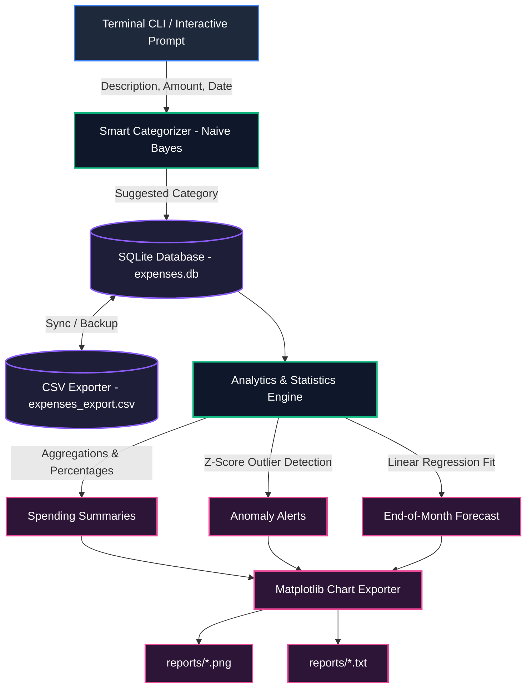
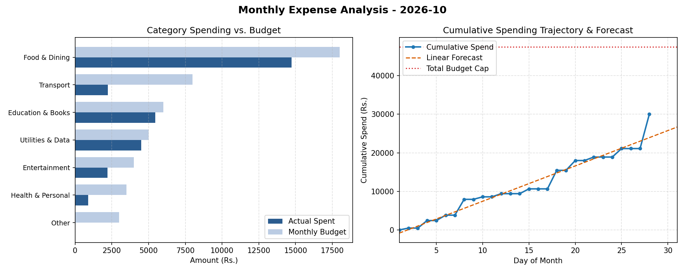
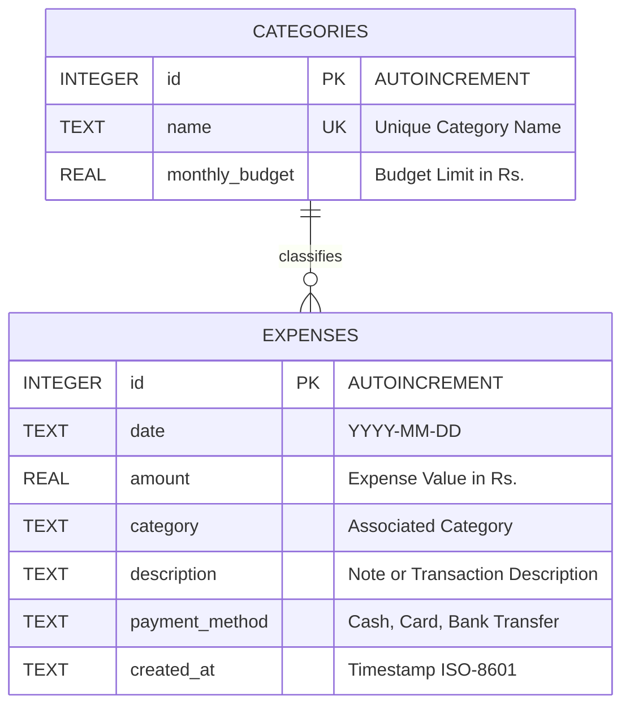

<div align="center">

  <!-- Animated Header / Typing Effect -->
  <a href="https://github.com/RanithuDewage/Expense-Tracker-System">
    
  </a>

  <p align="center">
    <strong>A high-performance, automated personal expense tracking and predictive financial analytics suite built with Python, SQLite, Pandas, NumPy, and Matplotlib.</strong>
  </p>

  <p align="center">
    <a href="#key-features">Key Features</a> •
    <a href="#system-architecture">Architecture</a> •
    <a href="#visual-analytics">Visual Reports</a> •
    <a href="#installation--quick-start">Quick Start</a> •
    <a href="#mathematical-models">ML & Statistics</a> •
    <a href="#license">License</a>
  </p>

  <!-- Badges -->
  <p align="center">
    
    
    
    
    
    
  </p>

  
</div>

---

## 📌 Table of Contents

- [Overview](#-overview)
- [Key Features](#-key-features)
- [System Architecture & Workflow](#-system-architecture--workflow)
- [Visual Analytics & Reports](#-visual-analytics--reports)
- [Mathematical & Statistical Models](#-mathematical--statistical-models)
- [Project Directory Structure](#-project-directory-structure)
- [Database Schema (ERD)](#-database-schema-erd)
- [Installation & Quick Start](#-installation--quick-start)
- [Interactive CLI Guide](#-interactive-cli-guide)
- [Contributing](#-contributing)
- [Author & Acknowledgments](#-author--acknowledgments)
- [License](#-license)

---

## 🌟 Overview

The **Expense Tracker System** is an end-to-end personal finance solution designed for individuals and students looking to track their daily expenditures, enforce rigorous budget limits, and discover actionable spending insights. 

Equipped with an intelligent **Naive Bayes Auto-Categorization Engine**, **Z-score Statistical Anomaly Detection**, and **Linear Regression Spending Forecasting**, this system turns raw transaction records into comprehensive financial intelligence reports with high-resolution visual plots.

```
       [ Add Expense ]
              │
              ▼
   [ Naive Bayes Classifier ] ────► Category & Budget Auto-Assignment
              │
              ▼
    [ Dual-Tier Storage ] ────────► SQLite3 Database + CSV Sync
              │
              ▼
    [ Analytics Engine ] ─────────► Pandas / NumPy Statistical Aggregations
              │
              ▼
     [ Reporting & Viz ] ─────────► Matplotlib Visual Dashboard & Text Summaries
```

---

## ⚡ Key Features

| Feature | Description |
| :--- | :--- |
| 🤖 **Smart Auto-Categorizer** | Uses a lightweight **Multinomial Naive Bayes** model with Laplace smoothing and seed keywords to automatically predict categories as you type descriptions. |
| 🛡️ **Dual-Tier Storage Architecture** | Primary ACID-compliant **SQLite** database (`expenses.db`) with instant **CSV Export / Import** capabilities for Excel or Pandas interoperability. |
| 📊 **Advanced Statistical Summaries** | Calculates total spend, transaction counts, mean/median expenses, daily average burn rate, peak spending dates, and percentage distribution. |
| 🎯 **Budget Enforcement & Alerting** | Configurable monthly category limits with real-time tracking (`On Track`, `Near Limit` at $\ge 90\%$, or `OVER BUDGET`). |
| 🔮 **Linear Trend Forecasting** | Applies ordinary least squares (`numpy.polyfit`) over cumulative daily spending to project month-end expenditure before the month closes. |
| 🚨 **Z-Score Anomaly Detection** | Highlights unusual or outsized transactions ($Z \ge 1.5$) against historical category means to catch impulse buys and errors. |
| 📈 **Automated Chart Generation** | Renders crisp dual-panel `matplotlib` visualizations comparing budget vs. actual spending alongside cumulative spending trajectories. |
| 🧪 **One-Click Demo Suite** | Built-in non-interactive demo runner (`python main.py --demo`) for automated evaluation and quick verification. |

---

## 🏗️ System Architecture & Workflow



---

## 📊 Visual Analytics & Reports

When a monthly report is requested, the system automatically writes an itemized text digest and exports a dual-panel visualization to the `reports/` directory.

### Sample Output Dashboard

<div align="center">
  
  <p><em>Dual-panel report showing (Left) Category Budget vs. Actual Spend with budget limit thresholds, and (Right) Cumulative Daily Spending trajectory with End-of-Month linear projection.</em></p>
</div>

### Formatted Monthly Summary (Console / `.txt`)

```text
EXPENSE TRACKER - MONTHLY REPORT (2026-10)
================================================================
Generated on       : 2026-10-30 19:46
Total Spent        : Rs. 30,000.00
Monthly Budget     : Rs. 47,500.00
Transactions       : 12 across 12 active days
Daily Average      : Rs. 2,500.00
Peak Spending Day  : 2026-10-28 (Rs. 8,900.00)
Projected Month End: Rs. 30,000.00 (Trend: ~Rs. 916.76/day)
Vs Previous Month  : +39.7% (Prev: Rs. 21,470.00)

CATEGORY BREAKDOWN & BUDGET STATUS
----------------------------------------------------------------
Category              Budget (Rs)   Spent (Rs)   Used %       Status
----------------------------------------------------------------
Food & Dining           18,000.00    14,730.00    81.8%     On Track
Transport                8,000.00     2,220.00    27.8%     On Track
Education & Books        6,000.00     5,450.00    90.8%   Near Limit
Utilities & Data         5,000.00     4,500.00    90.0%   Near Limit
Entertainment            4,000.00     2,200.00    55.0%     On Track
Health & Personal        3,500.00       900.00    25.7%     On Track
Other                    3,000.00         0.00     0.0%     On Track

UNUSUAL / HIGH EXPENSE ALERTS (Z-Score Anomaly Check)
----------------------------------------------------------------
- [2026-10-28] Food & Dining: Rs. 8,900.00 (Birthday treat dinner) | Cat Avg: Rs. 2,795.83 (Z=2.58)
- [2026-10-18] Education & Books: Rs. 4,800.00 (External SSD drive) | Cat Avg: Rs. 2,460.00 (Z=1.51)
```

---

## 🔬 Mathematical & Statistical Models

### 1. Smart Category Prediction (Multinomial Naive Bayes)

Given tokenized words $W = \{w_1, w_2, \dots, w_n\}$ from the user's description, the posterior probability of category $C$ is computed using Bayes' theorem with Laplace smoothing:

$$P(C \mid W) \propto P(C) \prod_{i=1}^{n} \frac{\text{count}(w_i, C) + 1}{\sum_{w \in V} \text{count}(w, C) + |V|}$$

Where:
- $P(C)$ is the prior probability based on past transaction frequency.
- $|V|$ is the total vocabulary size across all categories and seed keywords.
- Laplace smoothing ($+1$) guarantees non-zero probabilities for previously unseen words.

### 2. Spending Anomaly Detection (Z-Score)

Transactions are tested against each category's historical distribution to detect outliers:

$$Z = \frac{x - \mu_{\text{cat}}}{\sigma_{\text{cat}}}$$

- **Normal Spending**: $Z < 1.5$
- **High Outlier Warning**: $Z \ge 1.5$ (Flagged in console reports and visual charts)

### 3. End-of-Month Spending Projection (Linear Regression)

Using daily cumulative spending pairs $(d_i, S_i)$ where $d_i$ is the day of the month and $S_i$ is cumulative expenditure, a first-degree polynomial trend line is fit:

$$S(d) = m \cdot d + c$$

The slope $m$ (spending velocity in Rs./day) projects expenditure to the final day $D_{\text{last}}$ of the calendar month:

$$\hat{S}_{\text{month\_end}} = \max\left(S_{\text{current}}, \; m \cdot D_{\text{last}} + c\right)$$

---

## 📁 Project Directory Structure

```text
Expense-Tracker-System/
├── analyzer.py               # Statistical calculations, forecasting & Matplotlib plotting
├── categorizer.py            # Naive Bayes classifier & tokenized keyword predictor
├── database.py               # SQLite schema setup, CRUD operations & CSV synchronization
├── main.py                   # Terminal CLI interactive user interface & workflow runner
├── seed_data.py              # Sample dataset loader (preloaded with 35 realistic records)
├── requirements.txt          # Python external library specifications
├── .gitignore                # Git ignore configuration protecting sensitive data & databases
├── .env.example              # Sample environment template for configuration
├── README.md                 # Project documentation & visual showcase
├── data/
│   ├── expenses.db           # SQLite database (auto-generated on initial launch)
│   └── expenses_export.csv   # Human-readable CSV export dataset
└── reports/
    ├── monthly_report_2026-08.png / .txt
    ├── monthly_report_2026-09.png / .txt
    └── monthly_report_2026-10.png / .txt
```

---

## 🗄️ Database Schema (ERD)



---

## 🚀 Installation & Quick Start

### 1. Clone the Repository

```bash
git clone https://github.com/RanithuDewage/Expense-Tracker-System.git
cd Expense-Tracker-System
```

### 2. Create and Activate a Virtual Environment

```bash
# Windows (PowerShell / Command Prompt)
python -m venv venv
.\venv\Scripts\activate

# macOS / Linux
python3 -m venv venv
source venv/bin/activate
```

### 3. Install Dependencies

```bash
pip install -r requirements.txt
```

### 4. Run the Application

#### Option A: Interactive CLI Mode
```bash
python main.py
```
*(On first execution, `seed_data.py` auto-initializes the SQLite database with 35 curated expense records across August, September, and October 2026 so you can immediately explore analytics and reports.)*

#### Option B: Non-Interactive Workflow Demo
```bash
python main.py --demo
```
*(Executes all 5 stages: expense categorization, storage sync, statistical aggregations, month-over-month comparisons, and chart generation in automated batch mode.)*

---

## 💻 Interactive CLI Guide

Upon launching `python main.py`, the main menu presents 6 core modules:

```text
========================================================================
                     EXPENSE TRACKER SYSTEM
========================================================================
1. Add New Expense (with Auto-Categorizer)
2. Manage Categories & Monthly Budgets
3. View & Filter Expense Records
4. Spending Summaries & Category Breakdown
5. Monthly Reports, Forecasts & Visual Charts
6. Import / Export Data (CSV Sync)
7. Exit
========================================================================
```

- **Option 1**: Enter an expense description (e.g., `Keells grocery milk`); the Naive Bayes model instantly highlights the suggested category with its confidence score.
- **Option 2**: Adjust budget thresholds for existing categories or define custom categories.
- **Option 3**: Query expenses with optional month filtering (`YYYY-MM`) and delete records by ID.
- **Option 4**: Display statistical summaries including total spending, daily average, payment method share, and category distribution histograms.
- **Option 5**: Generate month-over-month performance tables and render high-resolution PNG charts directly into `reports/`.
- **Option 6**: Synchronize SQLite records to and from `data/expenses_export.csv`.

---

## 🔒 Security & Privacy Practices

- **Zero Hardcoded Secrets**: Sensitive API keys and credentials are not stored in source files.
- **Strict `.gitignore`**: SQLite database binaries (`*.db`), virtual environments (`venv/`), caches (`__pycache__/`), and OS files are completely prevented from entering source control.
- **Local Data Sovereignty**: All calculations and data storage remain 100% offline on your local machine.

---

## 🤝 Contributing

Contributions, feedback, and pull requests are welcome!

1. **Fork the Repository**
2. **Create a Feature Branch** (`git checkout -b feature/AmazingFeature`)
3. **Commit your Changes** (`git commit -m 'Add some AmazingFeature'`)
4. **Push to the Branch** (`git push origin feature/AmazingFeature`)
5. **Open a Pull Request**

---

## 👤 Author & Acknowledgments

- **Developer**: [Ranithu Dewage](https://github.com/RanithuDewage)
- **Email**: [ranithudewage@gmail.com](mailto:ranithudewage@gmail.com)
- **Project**: Auspify Internship Task 5 - Expense Tracker System (Advanced Level)

---

## 📄 License

This project is open-source and licensed under the [MIT License](LICENSE). Feel free to use, modify, and distribute it for personal, academic, or commercial purposes.

<div align="center">
  <sub>Built with ❤️ and Python by Ranithu Dewage</sub>
</div>
